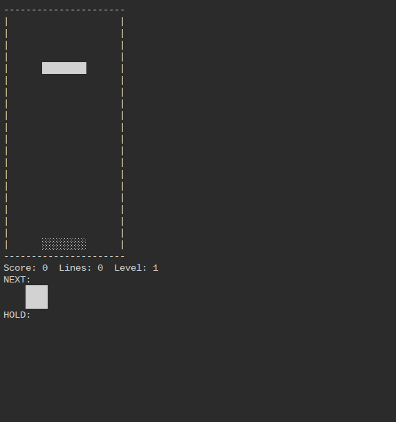
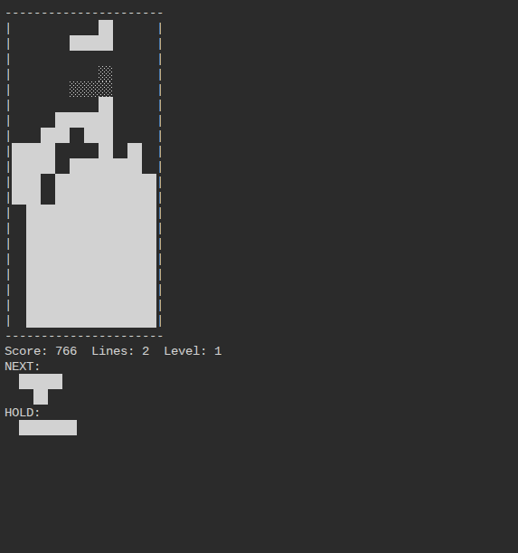
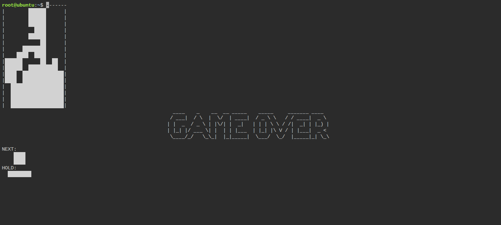

Tetris game I made using Python
# Requirements
* Pyfiglet
* Python3
* Ubuntu 20.04+(For App)
# Controls
| Key | Action |
|-----|--------|
| ↑ | Rotate CW |
| ← / → | Move |
| ↓ | Soft drop (1 pt/cell) |
| Space | Hard drop (2 pts/cell) |
| C / Z | Hold piece |
| ESC | Pause / Resume |
# Notes
I tried implementing SRS but I couldn't, so I had help from AI. The scoring is also based on NES scoring.
# Images

